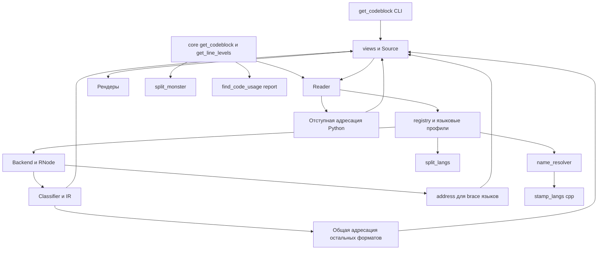

# Архитектура get_codeblock и приоритет технического долга

Ядро уже отделяет структуру от представления: `views` возвращает данные, рендеры превращают их в текст, языковые профили задают синтаксические правила. Основной риск находится на стыках этих слоёв: разные способы чтения файла, два представления Python-блока и использование подписи вместо машинного имени. Исправления стоит сосредоточить здесь, сохранив существующие языковые контракты.

## Поток данных и потребители

Это схема основных проверенных связей, а не полный граф импортов. `stamp_langs` для TypeScript и C# дополнительно использует `handlers/*_treesitter.py` через контракт объявлений; эти пути нельзя удалять только потому, что `Reader.outline` уже перешёл на IR.

## Контракты которые стоит сохранить

- `registry.resolve` остаётся единым входом к backend и Spec. Новые языковые особенности лучше помещать в профили и backend-адаптеры, сохраняя общие рендеры.
- Классификатор определяет структуру; `description` и будущие Analyzer не должны менять диапазоны. Смысл и структура разделены контрактом намеренно.
- Прозрачные namespace, `extern "C"` и preprocessor frames не прибавляют глубину. Границы между sibling-блоками на одной физической строке показываются явно.
- Filler — полноценный контейнер. Исправления адресации должны сохранять узкие полосы импортов, комментариев и присваиваний, а не заменять их всегда целым файлом.
- Эскалация малого query остаётся политикой views. Импортируемый `core.get_codeblock` нужен потребителям с точным диапазоном; переносить в него автоматический добор соседей нельзя без изменения контракта.
- Граф карточек и runtime seams остаются отдельным слоем. Расширять fact-fetcher до проектного графа ради исправления найденных ошибок не требуется.

## Согласованная версия файла

В [views.open_source](F:/WORK/ProjectStarter/__HQ/tools/get_codeblock/views.py:51) хранится текст, однако `Reader` и функции карты и адресации читают файл заново. Это одновременно источник R02 и причина повторного разбора. Кэш по пути сам по себе недостаточен: он может сделать старые данные ещё менее заметными.

Предлагаемый порядок: сначала явно определить время жизни снимка файла, затем передавать один источник текста и дерева всем операциям этого снимка. Для Python без грамматики можно сохранить отдельный алгоритм адресации, но кормить его теми же строками. Принятое в проекте решение о трёх движках адресации не требует трёх независимых чтений файла.

После этого cache key должен описывать содержимое или версию снимка и влияющие на разбор настройки. Проверка R02 должна исключать смешивание текста одной версии и диапазонов другой даже при замене файла между обращениями.

## Повторный разбор уже является известным долгом

В TLDR и reader CONTRACT пакетный вызов обещает один разбор. Фактически для трёх якорей TypeScript воспроизведение зафиксировало:

| Операция | Вызовов TSBackend.root |
|---|---:|
| `query_view(..., [2,3,7], ..., force=True)` | 6 |
| `get_line_levels(..., [2,3,7])` | 3 |

Счётчик оборачивает `TSBackend.root` и после проверки восстанавливает метод; параметры разрешения блоков не меняются. Это число вызовов backend, не замер времени.

Поведение уже описано как отложенное в [escalate.py](F:/WORK/ProjectStarter/__HQ/tools/get_codeblock/escalate.py:22), а `test/sweep_invariants.py` отдельно кеширует разбор и обходы для ускорения теста. Поэтому это **подтверждение известного долга**, а не одиннадцатая новая находка.

Последствия касаются не только CLI: [find_code_usage/report.py](F:/WORK/ProjectStarter/__HQ/tools/find_code_usage/report.py:46) запрашивает уровни для найденных использований. На больших файлах количество разборов растёт с количеством строк запроса. Исправлять это удобнее вместе с согласованным Source, затем измерить один и множество якорей на одном большом файле без monkeypatch ускорений из тестового sweep.

## Имена должны отличаться от подписей

`Spec.name` сегодня отдаёт удобную человеку подпись, а `name_resolver` пытается восстановить из узлов машинное имя. R05–R07 показывают три разных проблемы: квалификатор теряется при glob, инструкция может объявлять несколько имён, а fallback подставляет display label.

Нужна небольшая общая модель объявлений: имя, квалификаторы, координаты и подпись отдельно. Её можно отдавать через опциональный контракт Spec или другой согласованный seam ридера. Общая логика сопоставления тогда работает с нормализованными именами, а рендер продолжает использовать исходную подпись. Копировать набор языковых regex в общий resolver не стоит.

Такая модель пригодится и `split_langs`, где сейчас есть собственный проход `_def_name`, но объединять эти пути следует после фиксации поведения на тестах. Крупная миграция одновременно с исправлением всех ошибок увеличит риск для уже работающих штемпеля и разрезания.

## Пробелы в проверках

601 штатная проверка покрывает регресс существующих примеров. Они не опровергают R01–R10: дополнительные воспроизведения выполняют операции, которых в этих наборах нет. Особенно нужны проверки согласованности между двумя независимыми ответами:

1. Карта определения и query по его заголовку совпадают, включая многострочные декораторы.
2. `Source.lines`, диапазоны и framing относятся к одному содержимому.
3. Физические строки имеют одинаковые координаты во всех backend-ах, включая Unicode и EOL.
4. Точное имя остаётся точным и в AST fallback; квалифицированный glob сохраняет ограничение пространства имён.
5. Файл с оградой Markdown длиннее трёх символов не создаёт ложные заголовки.

Штатный sweep проверяет главным образом containment, отношения диапазонов, уровни и наличие строки в тексте. Согласованно неверная карта, лишние кандидаты или удалённый декоратор могут пройти эти условия. Отдельно sweep ускоряет runtime через monkeypatch, поэтому его нельзя использовать как benchmark производительности production API.

## Состояние документации

В [reader CONTRACT](F:/WORK/ProjectStarter/__HQ/tools/get_codeblock/reader/CONTRACT.md:149) одновременно остаются финальное описание `■BLOCK` и старые утверждения про `[i/n]`; упомянута версия `0.5.0`, тогда как `core.VERSION` равна `0.8.0`. В `DECISIONS.md` также есть старое описание default root для fact-fetcher, расходящееся с более свежими TLDR и `core._main_impl`.

При обновлении документации стоит оставить один нормативный раздел текущего формата и явно отделить историю решений. В этом ревью нормативными для пути файла считались более свежие TLDR и реализация с предупреждением при конфликте root и cwd. Сам механизм не объявлен ошибкой только из-за старой записи.

## Известные ограничения вне новых дефектов

REQ-014 про внутреннюю структуру тела Markdown-раздела, плоский JSX, деградация SCSS на CSS-грамматике и cp1252-фикстура для `replace_in_files` уже описаны проектом. Они не посчитаны повторно как новые находки. Пример R04 относится к неверной обработке ограды, а не к отсутствию разбивки тела раздела из REQ-014.

## Порядок изменений

Сначала зафиксировать воспроизведения R01–R04 проверками поведения и исправить координаты и источник текста. Затем исправить поиск имён R05–R07, согласовать сохранение EOL и коды возврата R08–R10. После этого отдельным изменением завершить работу над снимком и повторным разбором, измерить стоимость на больших файлах и обновить нормативные разделы документации.

После каждого смыслового изменения достаточно прогонять затронутые проверки; перед объединением — штатные наборы из [VALIDATION.md](VALIDATION.md). Это позволит сохранить существующие языковые и интеграционные контракты без большого переписывания ядра.
